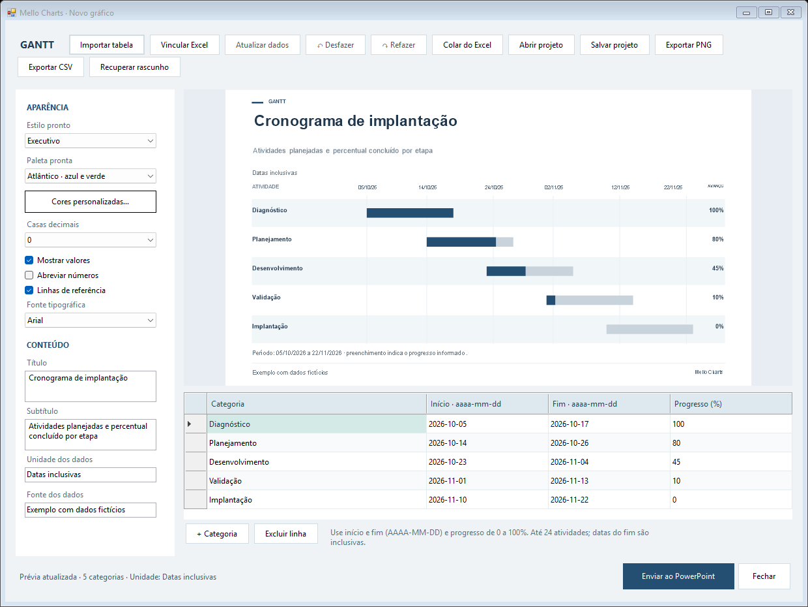
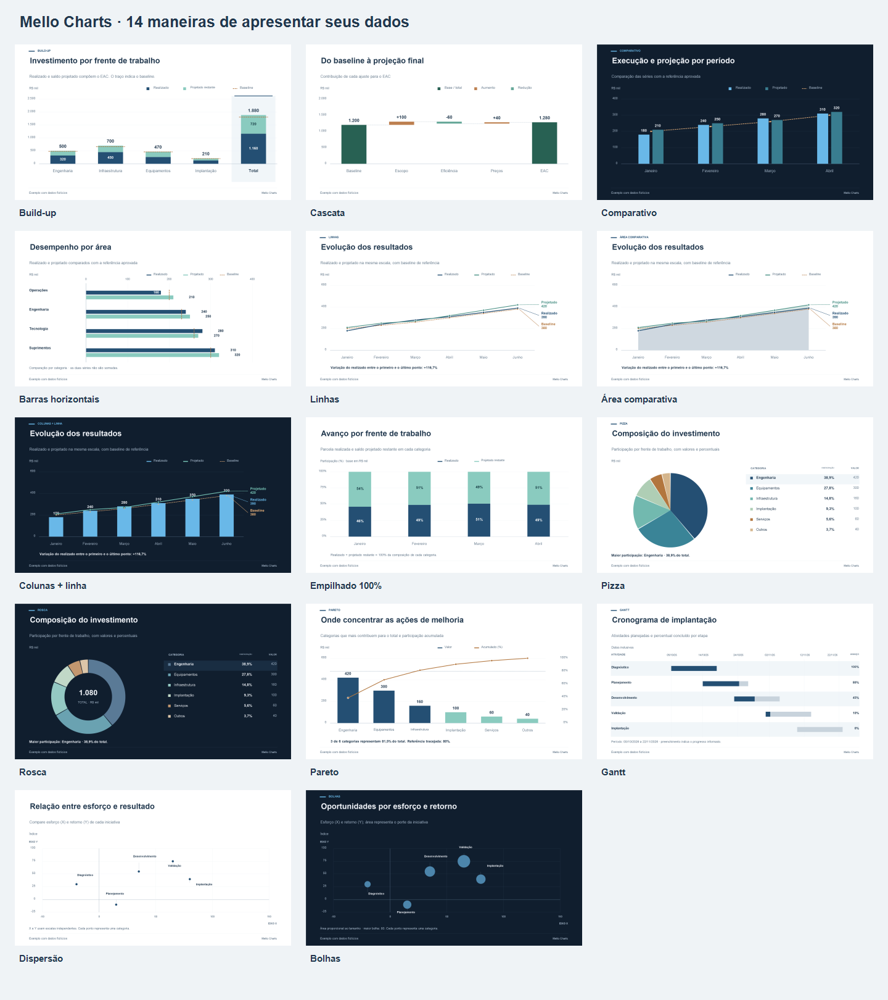

# Mello Charts

**Do Excel à apresentação. Gráficos claros, dados conectados e elementos editáveis no PowerPoint.**

Aplicativo desktop e suplemento para Windows, desenvolvido em C# com .NET Framework 4.8. Versão **0.8.0 experimental**.

**[Baixar instalador](https://github.com/andremellotech/mello-charts-desktop/raw/refs/heads/main/release/MelloCharts-Setup.exe)** · **[Editor portátil](https://github.com/andremellotech/mello-charts-desktop/raw/refs/heads/main/release/MelloCharts-Portable.zip)** · [Instalação](docs/install-guide.md) · [Guia do editor](docs/native-integration.md) · [Exemplos](examples/gallery/README.md)



## Criar, revisar, apresentar

- **14 modelos:** cascata, build-up, colunas, barras, linhas, área, combinado, empilhado 100%, pizza, rosca, Pareto, Gantt, dispersão e bolhas.
- **Entrada pelo Excel:** selecione uma tabela com cabeçalhos e use **Mello Charts → Criar da seleção**.
- **Planilha e intervalo:** escolha a aba e um intervalo A1 de um XLSX salvo, com prévia antes de importar.
- **Atualização dos dados:** o vínculo fica no projeto e no gráfico. Salve as alterações no Excel e use **Atualizar dados** no editor; aplique ao slide para concluir.
- **Controle da edição:** desfazer/refazer, prévia do último estado válido, nomes de séries, fontes, estilos e cores da marca.
- **Saídas úteis:** grupos de formas e textos editáveis no PowerPoint, PNG 1920×1080, CSV e projeto JSON.
- **Trabalho local:** não exige conta Mello Charts, assinatura ou serviço de nuvem.

## Começar

**No PowerPoint:** selecione um slide, abra a galeria, escolha o modelo, edite os dados e clique em **Inserir no slide**. Para alterar depois, selecione o grupo e use **Editar dados**.

**No Excel:** selecione uma tabela contínua com cabeçalhos, escolha **Criar da seleção**, revise no editor e use **Enviar ao PowerPoint**. O primeiro envio cria uma apresentação nova; os seguintes atualizam o mesmo gráfico.

**Sem instalar:** extraia todo o ZIP portátil para uma pasta e abra `MelloCharts.exe`. O editor importa dados e exporta PNG/CSV/JSON; o envio ao PowerPoint exige o aplicativo desktop instalado.

O instalador registra as abas no Excel e no PowerPoint para o usuário atual. Salve os documentos e feche ambos antes de instalar. Windows 10/11 Intel/AMD e .NET Framework 4.8; integração Office desktop 32/64 bits. Office na Web e macOS não são suportados. O binário ainda não tem assinatura digital comercial; a instalação corporativa depende das regras da organização.

## Qual modelo usar

| Objetivo | Modelos |
| --- | --- |
| Explicar um resultado financeiro | Build-up, cascata |
| Comparar categorias | Colunas, barras horizontais |
| Mostrar evolução | Linhas, área, colunas + linha |
| Compor e priorizar | Empilhado 100%, pizza, rosca, Pareto |
| Planejar atividades | Gantt com início, fim e progresso |
| Relacionar indicadores | Dispersão e bolhas com área proporcional |



## Dados e vínculos

CSV/TSV e a área copiada do Excel devem incluir cabeçalhos. Exemplos:

```text
categoria;realizado;projetado;baseline
Engenharia;320;180;480
```

```text
categoria;inicio;fim;progresso
Diagnóstico;2026-10-05;2026-10-17;100
```

```text
categoria;x;y;tamanho
Iniciativa A;15;40;80
```

O campo `tamanho` é exclusivo de bolhas. Dispersão usa categoria/X/Y. Gantt aceita datas ISO, DD/MM/AAAA e datas numéricas do Excel; o progresso é de 0 a 100. Percentuais formatados no Excel são convertidos para essa escala. Os 11 modelos anteriores mantêm seus formatos de tabela.

O vínculo XLSX guarda caminho local, aba e intervalo. Não há leitura contínua em segundo plano. A atualização lê a versão **salva** do arquivo e não recalcula fórmulas; resultados em cache devem estar atualizados pelo Excel. Colar dados ou importar CSV cria uma cópia sem vínculo. O caminho da origem fica nos metadados do PPTX/JSON; revise-o antes de compartilhar o projeto.

Limites: 12 categorias nos modelos anteriores, 24 atividades no Gantt e 80 pontos em dispersão/bolhas. XLSX até 10 MB, 64 colunas selecionadas e 16.384 células examinadas por aba. Referências externas e caminhos de rede são recusados. Categorias numéricas com formatos de data e códigos com zeros são preservadas; para formatos personalizados não suportados, converta a categoria em texto. Projetos JSON anteriores continuam compatíveis.

## Validação

Em 28/10/2026: 273 verificações automatizadas e renderização local aprovadas; teste COM no PowerPoint Microsoft 365 16.0.20527.20088 criou, atualizou e salvou os 14 modelos, preservando dados, tamanho, posição e rotação. Teste Excel da mesma versão confirmou segunda aba, intervalo H500:K502, fórmulas, atualização salva, datas 1904 e percentuais. [Evidências e limites](docs/verification.md).

A instalação e a ativação das abas pelo instalador ainda precisam de aceitação no computador de destino. A integração COM foi testada diretamente; isso não comprova as políticas ou a instalação de cada organização.

## Desenvolvimento

```powershell
./build.ps1 -RunTests -RenderGallery
# Testes opcionais com Office instalado; criam documentos separados:
./test-office.ps1
./test-excel.ps1
```

O build usa o compilador do .NET Framework, sem NuGet. Gera instalador, editor portátil e SHA-256 em `release/`. A CI Windows executa testes e publica os pacotes como artefatos. Os testes nativos do Office exigem uma máquina com os aplicativos instalados.

MIT · André Mello · [Histórico](CHANGELOG.md) · [Como contribuir](CONTRIBUTING.md)
