# Galeria de gráficos

Todos os dados são fictícios. Abra um JSON pelo botão **Abrir projeto**, ou importe o CSV no tipo correspondente. Os PNGs usam o mesmo desenho da prévia e da exportação.

## Build-up

Realizado e saldo na mesma coluna.

[Projeto JSON](buildup-executivo.json) · [Tabela CSV](buildup-executivo.csv)

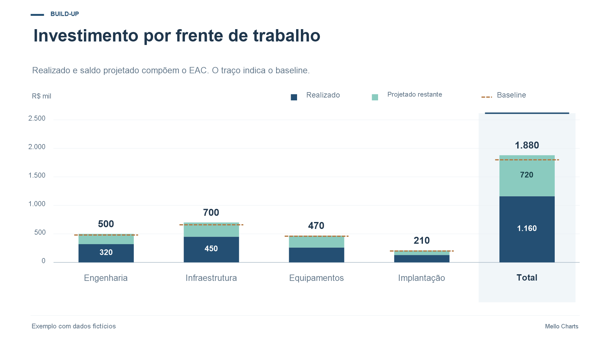

## Cascata

Explique as variações até o resultado final.

[Projeto JSON](cascata-essencial.json) · [Tabela CSV](cascata-essencial.csv)

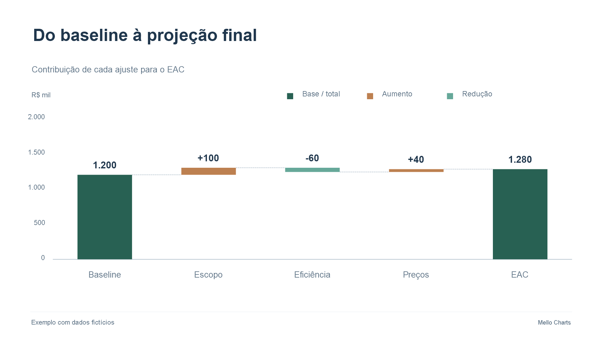

## Comparativo

Duas séries em colunas com referência.

[Projeto JSON](comparativo-escuro.json) · [Tabela CSV](comparativo-escuro.csv)

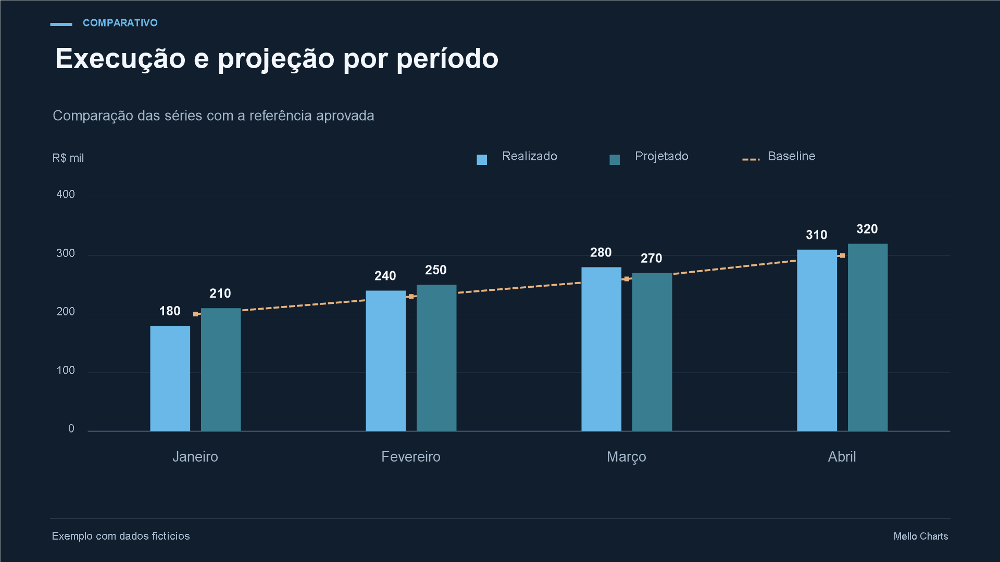

## Barras horizontais

Compare categorias com nomes longos.

[Projeto JSON](barras-horizontais.json) · [Tabela CSV](barras-horizontais.csv)

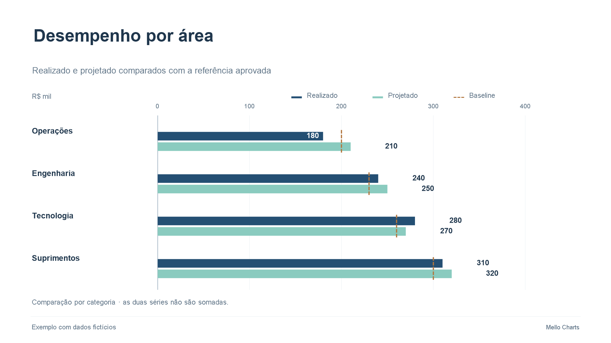

## Linhas

Mostre tendências com marcadores e rótulos finais.

[Projeto JSON](linhas.json) · [Tabela CSV](linhas.csv)

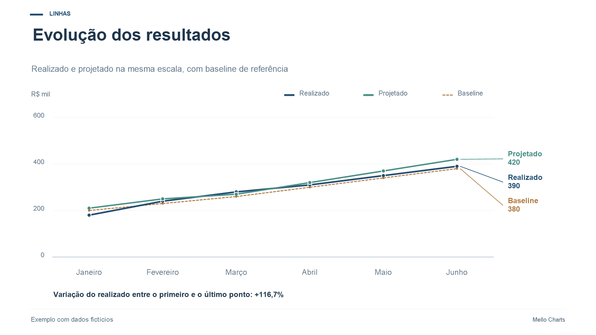

## Área comparativa

Destaque a magnitude de duas séries positivas.

[Projeto JSON](area-comparativa.json) · [Tabela CSV](area-comparativa.csv)

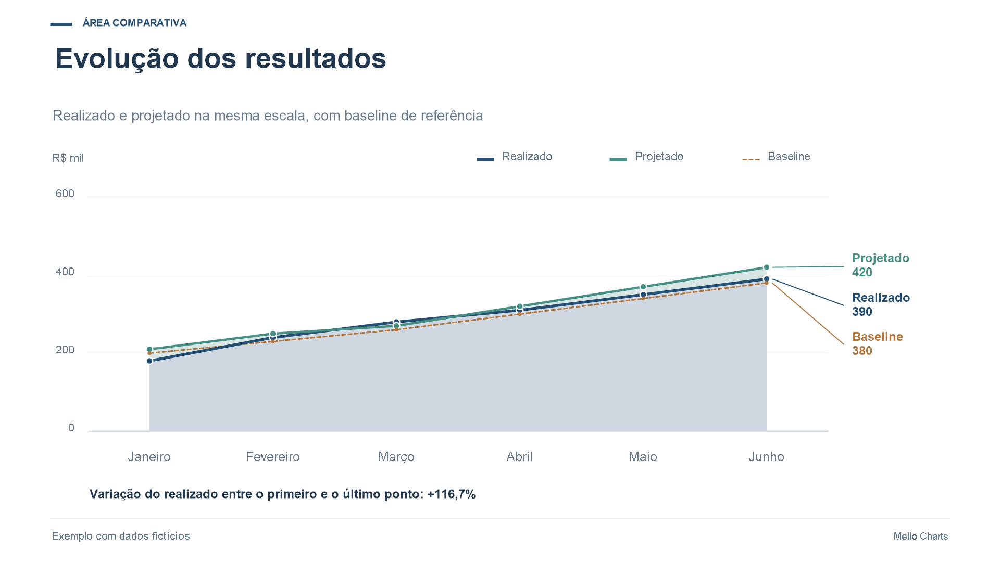

## Colunas + linha

Realizado em colunas, projetado em linha.

[Projeto JSON](combinado.json) · [Tabela CSV](combinado.csv)

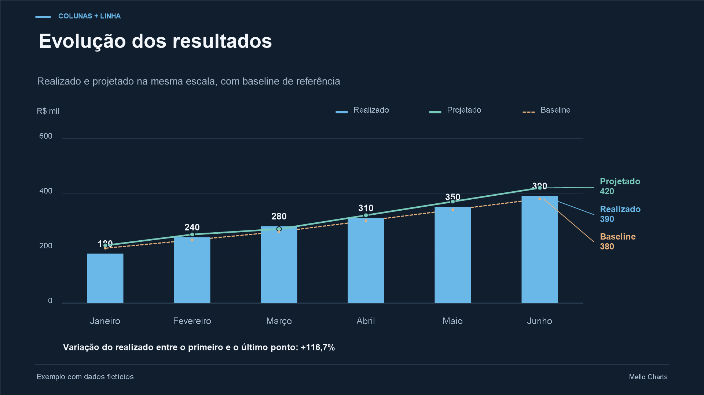

## Empilhado 100%

Compare participação realizada e saldo restante.

[Projeto JSON](empilhado-100.json) · [Tabela CSV](empilhado-100.csv)

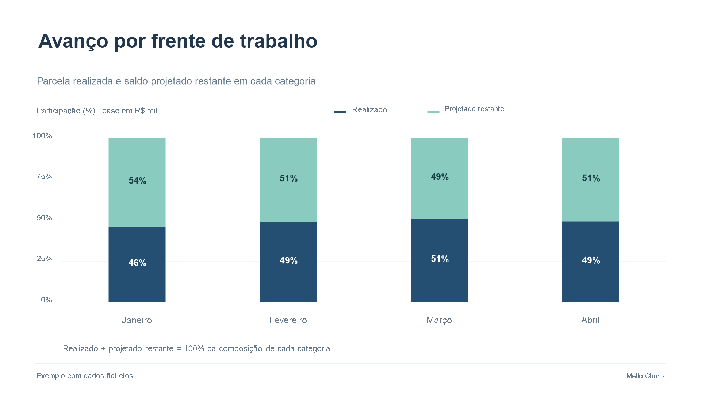

## Pizza

Distribua um total entre categorias.

[Projeto JSON](pizza.json) · [Tabela CSV](pizza.csv)

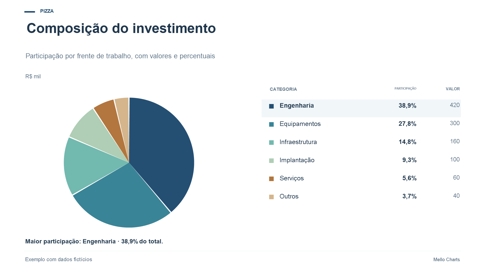

## Rosca

Participação das categorias com total central.

[Projeto JSON](rosca.json) · [Tabela CSV](rosca.csv)

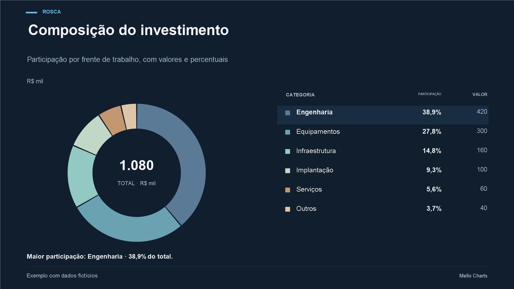

## Pareto

Priorize categorias pela contribuição acumulada.

[Projeto JSON](pareto.json) · [Tabela CSV](pareto.csv)

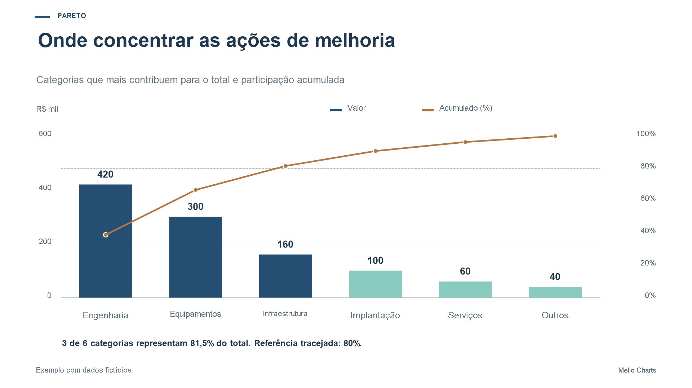
